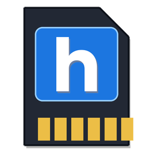

<div align="center">



# 3DS SD Manager

**Manage your Nintendo 3DS SD card on Windows - clean, update, format, verify and set up, all in one small app.**

[](https://github.com/xyemii/3DS-SD-Manager/actions/workflows/build.yml)


[](LICENSE)

[Features](#-features) · [Screenshots](#-screenshots) · [Build](#-build) · [Usage](#-usage) · [Disclaimer](#-disclaimer)

</div>

---

A Windows tool for your Nintendo 3DS SD card: find and delete homebrew, clean up macOS/Windows junk files, update Luma3DS & co. from GitHub, format cards as FAT32, detect fake-capacity cards, and set up a starter pack for Old/New 3DS.

> [!WARNING]
> **Early version.** Deleting, formatting and the capacity test work directly on the card. Back up anything important first (especially `/gm9/backups` and save-game backups such as `/3ds/Checkpoint/saves`) and try the destructive features on a spare card before using them on your main one.

## ✨ Features

| | Tab | What it does |
| :-: | --- | --- |
| 🚀 | **Starter pack** | Pick *Old* or *New 3DS* and the app downloads the latest **Luma3DS** and **boot9strap** from their official GitHub releases onto the card. Optionally adds the *finalize* files for the second setup phase of the [3DS Hacks Guide](https://3ds.hacks.guide). Can remove unnecessary files first (after confirmation). |
| 🔄 | **Modules and updates** | Compares the modules on your card (Luma3DS, GodMode9, Universal-Updater, Checkpoint, FBI, ftpd, Anemone3DS) with the latest GitHub releases and updates the ones you tick. |
| 🧰 | **Homebrew** | Lists everything it finds: `.3dsx` apps (name and author read from the file), CIA installers, Luma plugins and payloads, themes, cheats and more. Tick entries and delete them. Core CFW and backup folders are marked **red** and need a second confirmation. |
| 🧹 | **Junk (macOS/Windows)** | Finds `._*` files, `.DS_Store`, `.Spotlight-V100`, `.Trashes`, `.fseventsd`, `.TemporaryItems`, `__MACOSX`, `Thumbs.db`, `desktop.ini` and leftover ZIP/7z/RAR files in the root. All preselected. |
| 💾 | **SD tools** | **Format as FAT32** (Windows' formatter up to 32 GB, a built-in formatter above that) and an **H2testw-style capacity test** that exposes fake cards. |

**What it deliberately does not do**

- Run the exploit for you - that happens on the console, the app only prepares the card.
- Touch `/Nintendo 3DS` (installed titles and save data) or `/DCIM`. Only the junk scan looks inside, and it only removes the junk files listed above.
- Ship any third-party binaries. Everything is downloaded at runtime from the upstream projects' official releases.

## 📸 Screenshots

<table>
  <tr>
    <td align="center" width="50%">
      
      <br><sub><b>Starter pack</b> - choose your model and install the files</sub>
    </td>
    <td align="center" width="50%">
      
      <br><sub><b>Modules and updates</b> - check and update from GitHub</sub>
    </td>
  </tr>
  <tr>
    <td align="center" width="50%">
      
      <br><sub><b>Homebrew</b> - find and delete what you select</sub>
    </td>
    <td align="center" width="50%">
      
      <br><sub><b>SD tools</b> - FAT32 formatting and capacity test</sub>
    </td>
  </tr>
</table>

## 🛠 Requirements

- Windows 10 or 11 (the .NET Framework 4.x that ships with Windows is enough)
- Internet access for the starter pack and module updates
- Administrator rights for formatting (the app can restart itself elevated)

## 🔨 Build

No SDK needed - the build script uses the C# compiler that ships with Windows:

```bat
build.bat
```

This produces `bin\SD-Manager-3DS.exe`. A GitHub Actions workflow builds the executable on a Windows runner on every push and uploads it as a build artifact.

## 📖 Usage

1. Insert the SD card and start `SD-Manager-3DS.exe`. The card is detected automatically (or pick a drive/folder at the top).
2. **Fresh card:** *SD tools* → format as FAT32 if needed, then *Starter pack* → choose your model → *Install pack to SD*. Follow the guide for your model (the **Exploit page for my model** button opens it), then come back for *Phase 2*.
3. **Tidy up:** scan, then use the *Homebrew* and *Junk* tabs to delete what you no longer want.
4. **Update:** *Modules and updates* → *Check for updates* → *Update selected*.

<details>
<summary><b>Good to know</b></summary>

- The app only knows module versions it installed itself (stored in a hidden `.sdmanager3ds.txt` on the card). Everything else shows as *unknown*.
- Apps installed as CIA in the HOME Menu are best updated on the console with Universal-Updater.
- The capacity test only checks the **free** space - empty the card first for a full check. On slow cards it can take roughly an hour per 32 GB.
- Exploit-specific files (for example the super-skaterhax ZIP for your region and system version) depend on your console and are not downloaded by the app - follow the guide.

</details>

## ⚠️ Disclaimer

This is an unofficial community tool and is not affiliated with or endorsed by Nintendo or the authors of Luma3DS, boot9strap, GodMode9 or the 3DS Hacks Guide. It does not contain or distribute games, keys or other copyrighted material. Modifying a console and deleting or formatting storage carries risk, and you are responsible for what you do with your devices. The software is provided as is, without warranty (see [LICENSE](LICENSE)).

## 🙏 Credits

- [3DS Hacks Guide](https://3ds.hacks.guide) - the setup instructions the starter pack follows
- [Luma3DS](https://github.com/LumaTeam/Luma3DS), [boot9strap](https://github.com/SciresM/boot9strap), [GodMode9](https://github.com/d0k3/GodMode9), [Universal-Updater](https://github.com/Universal-Team/Universal-Updater), [Checkpoint](https://github.com/FlagBrew/Checkpoint), [FBI](https://github.com/nh-server/FBI-NH), [ftpd](https://github.com/mtheall/ftpd), [Anemone3DS](https://github.com/astronautlevel2/Anemone3DS)
- The app icon is original artwork (a microSD card with an "h") and not the official Homebrew logo. The letter was drawn with the [Poppins](https://fonts.google.com/specimen/Poppins) font (SIL Open Font License).

## 📄 License

[MIT](LICENSE)
